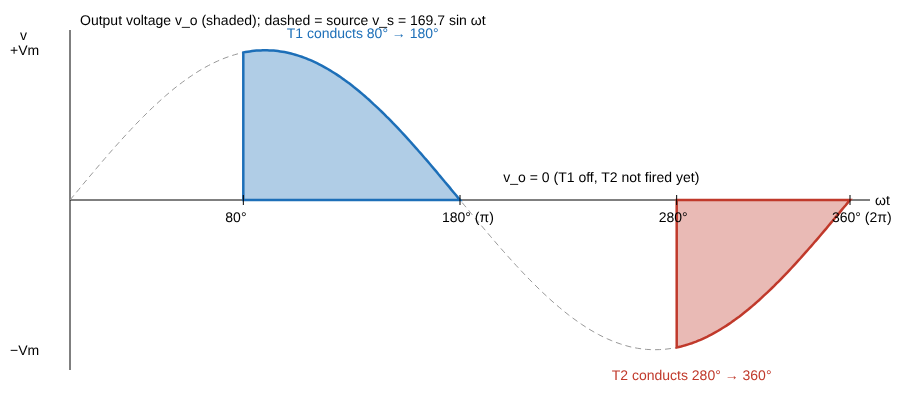

# Assessment #7 (Lecture 34): Single-Phase AC Voltage Controller, Solved with Integrals

**Question.** A single-phase full-wave AC voltage controller has a resistive load R = 10 Ω and input V_s = 120 V (rms), 60 Hz. The delay angles of T1 and T2 are 80° and 180° + 100° respectively. Draw the output waveform and find (a) the rms output voltage V_o, (b) the input power factor.

## Step 1: Source voltage
v_s(ωt) = V_m sin ωt, with V_m = √2 × 120 = **169.71 V**, so V_m² = 2 × 120² = **28 800 V²**.

## Step 2: When each thyristor conducts (R load: current stops when voltage reaches zero)
- **T1** (positive half): fired at α₁ = 80°, conducts until the voltage crosses zero at 180°. So v_o = v_s for **80° ≤ ωt ≤ 180°**.
- **T2** (negative half): fired at 180° + 100° = 280°, conducts until 360°. So v_o = v_s for **280° ≤ ωt ≤ 360°**.
- Everywhere else, v_o = 0.

The two halves are **not equal**: T1 is delayed by 80° in its half, T2 by 100° in its half.

## Step 3: RMS from the definition
V_o² = (1/2π) ∫ over one period of v_o² d(ωt)

V_o² = (1/2π) [ ∫ from 80° to 180° of V_m² sin²θ dθ + ∫ from 280° to 360° of V_m² sin²θ dθ ]

Only one identity is needed: **sin²θ = (1 − cos 2θ)/2**, so

∫ sin²θ dθ = **θ/2 − (sin 2θ)/4**   (call this F(θ))

## Step 4: First integral (T1, 80° to 180°)
Convert angles to radians: 80° = 1.3963 rad, 180° = π = 3.1416 rad.

- F(π) = π/2 − sin(2π)/4 = 1.5708 − 0 = 1.5708
- F(80°) = 1.3963/2 − sin(160°)/4 = 0.6981 − 0.3420/4 = 0.6981 − 0.0855 = 0.6126

**I₁ = F(π) − F(80°) = 1.5708 − 0.6126 = 0.9582**

## Step 5: Second integral (T2, 280° to 360°)
280° = 4.8869 rad, 360° = 2π = 6.2832 rad. Note sin(560°) = sin(200°) = −0.3420.

- F(2π) = 6.2832/2 − sin(4π)/4 = 3.1416 − 0 = 3.1416
- F(280°) = 4.8869/2 − sin(560°)/4 = 2.4435 − (−0.3420)/4 = 2.4435 + 0.0855 = 2.5290

**I₂ = F(2π) − F(280°) = 3.1416 − 2.5290 = 0.6126**

Check: I₂ < I₁, as it should be, because T2 conducts for only 80° and T1 for 100°.

## Step 6: (a) RMS output voltage
I₁ + I₂ = 0.9582 + 0.6126 = **1.5708 = π/2** (the two halves add up exactly to π/2, because 80° and 100° are symmetric about 90°)

V_o² = (V_m²/2π) × (π/2) = V_m²/4 = 28 800/4 = 7200 V²

**V_o = √7200 = 84.85 V**   (equal to V_m/2)

## Step 7: (b) Input power factor
- Load current rms: I_o = V_o/R = 84.85/10 = **8.485 A**
- Source current = load current (series circuit): I_s = 8.485 A
- Power to the resistor: P = I_o²R = 8.485² × 10 = **720 W**
- Apparent power from the source: S = V_s × I_s = 120 × 8.485 = **1018.2 VA**

**PF = P/S = 720/1018.2 = 0.707 (lagging)**

Shortcut check: for a resistive load, PF = V_o/V_s = 84.85/120 = 0.707.

## Bonus: why the teacher used unequal angles (DC component)
V_dc = (1/2π)[ ∫ from 80° to 180° of V_m sin θ dθ + ∫ from 280° to 360° of V_m sin θ dθ ]
= (V_m/2π)[ (cos 80° − cos 180°) + (cos 280° − cos 360°) ]
= (169.71/2π)[ (0.1736 + 1) + (0.1736 − 1) ] = 27.01 × 0.3473 = **9.38 V**

Unequal firing angles put a **DC component** in the output. That is harmful for transformers and motors (core saturation), which is why practical controllers use equal delays.

## Answers
| Quantity | Value |
|---|---|
| V_o (rms) | **84.85 V** |
| I_o (rms) | 8.485 A |
| P | 720 W |
| Input PF | **0.707 lagging** |
| DC component (bonus) | 9.38 V |
